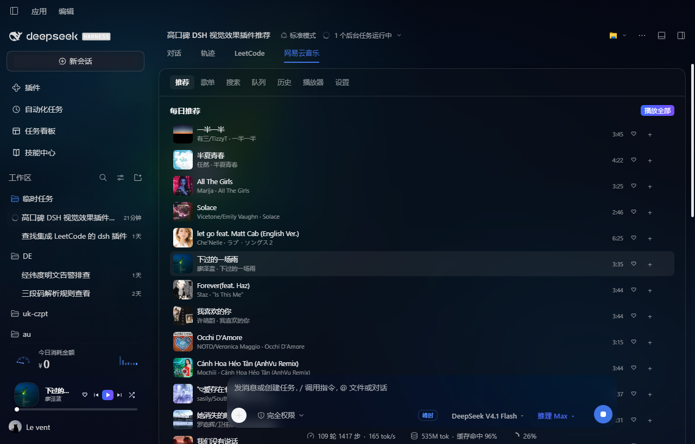
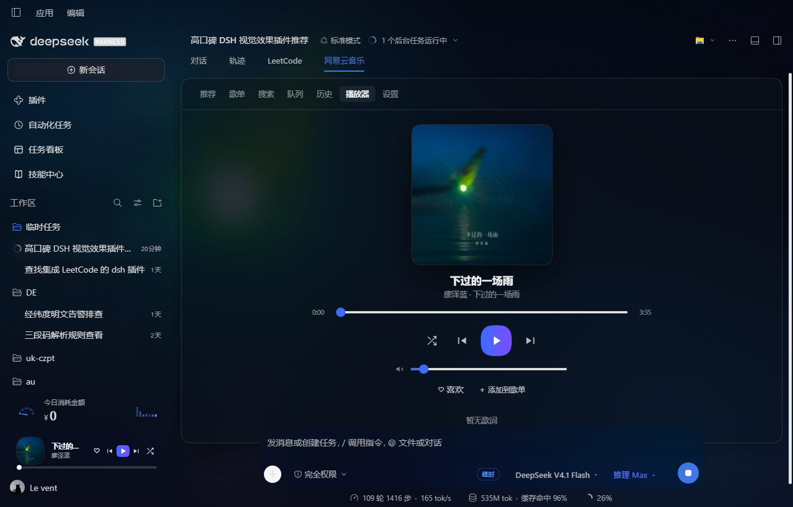
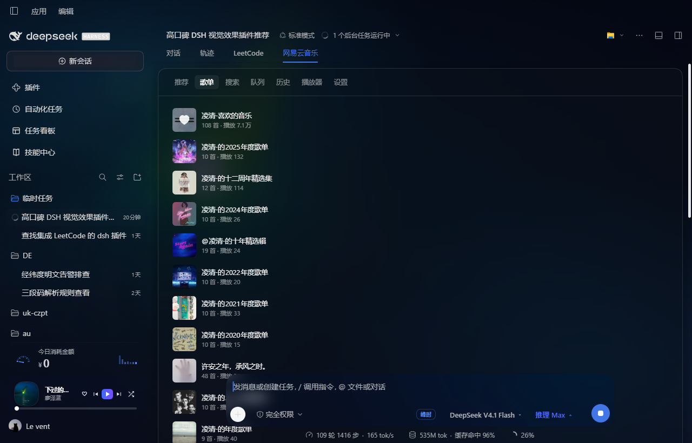
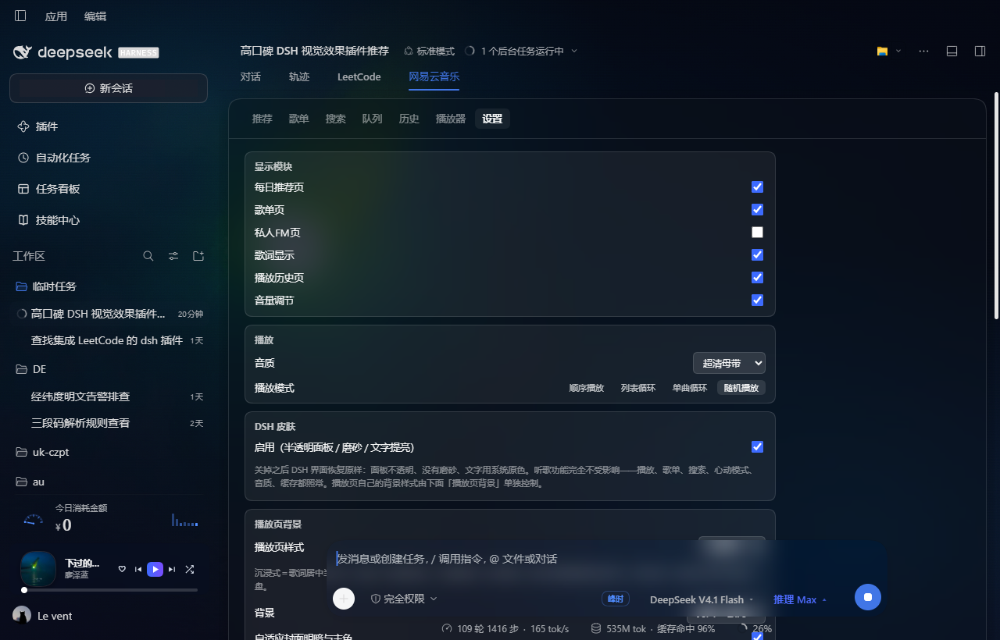

# dsh-netease-music

网易云音乐播放插件，为 [DeepSeek Harness](https://github.com/deepseek-ai)（DSH）提供**页签内播放器** + **侧栏迷你播放器** + **全窗口沉浸式背景**。

**直连模式**：Host 半部直接调用 `music.163.com` 的接口，不需要本地 API 服务、不需要 `NeteaseCloudMusicApi`、零第三方依赖（仅 Node 内置模块 + `ctx.webServer`）。

---

## 截图

| 每日推荐 | 播放器 |
|---|---|
|  |  |
| 进页签自动加载，列表自上而下逐条渐入 | 沉浸式背景：封面取色铺满全屏，歌词居中 |

| 我的歌单 | 设置 |
|---|---|
|  |  |
| 同样进页签自动加载 | 含 DSH 皮肤总开关（关掉后 DSH 恢复原生外观，听歌功能不受影响） |
## 功能

| 模块 | 说明 |
|---|---|
| 每日推荐 | 登录后拉取当日推荐 |
| 我的歌单 | 歌单列表 / 详情 / 播放全部 |
| 心动模式 | 作为播放模式的一档，仅「我喜欢的音乐」可用（原因见下） |
| 搜索 | 歌曲搜索并直接播放 |
| 队列 / 历史 | 当前播放队列与本次会话播放历史 |
| 歌词 | 原文 + 译文自动合并（按时间轴对齐，不是按行号） |
| 音质 | `standard` / `higher` / `exhigh` / `lossless` / `hires` / `jymaster`，另含「自动最高」逐级探测 |
| 红心 / 收藏到歌单 | 写操作走 eapi 加密通道（见下） |
| 播放页背景 | 模糊封面 + 封面取色 + 噪点，4 种播放页样式 |
| 侧栏迷你播放器 | 与「今日消耗金额」卡片同宽同高、上下堆叠 |

---

## 安装

```bash
# 在 DSH profile 目录内执行
pnpm add 'link:<本仓库绝对路径>'
```

然后在 profile 的 `package.json` 里把 `dsh-netease-music` 追加到 `dsh.profile.bundles`。

`cordis.patch.yml` 负责把 Host 半部插进 host Loader；Client 半部由 `package.json` 的 `dsh.client` 声明、在 web 平台名册中自动发现。

### 登录

插件设置页有两种方式：

- **扫码登录**：扫二维码后自动写入 Cookie
- **粘贴 Cookie**：从浏览器开发者工具复制完整 Cookie 字符串

Cookie 存在 `~/.dsh/profiles/<profile>/netease-music.json`（权限 `0600`），**不在本仓库内**，`.gitignore` 也额外兜了一层。

---

## 技术要点

### 1. 写操作必须走 eapi 加密通道

明文 `/api/` 的写操作会被网易云风控拒绝（`code=524 当前环境异常`）。红心、收藏到歌单等**写操作全部走 eapi**：

```
message = `nobody${path}use${text}md5forencrypt`
payload = `${path}-36cd479b6b5-${text}-36cd479b6b5-${md5(message)}`
params  = AES-128-ECB(payload, 'e82ckenh8dichen8') → 大写十六进制
POST https://interface.music.163.com/eapi<path>   body: params=<hex>
```

`e82ckenh8dichen8` 是网易云客户端内置的公开密钥（公开在多个开源项目里），不是本项目的秘密。

已排除的原因：缺少 `csrf_token`、缺少环境 Cookie、易盾风控 token、伪造中国 IP 头、`MUSIC_A`。**读操作明文可用，只有写操作需要加密。**

### 2. 心动模式只支持特定歌单类型

实测：自建歌单、收藏歌单调用 `/api/playmode/intelligence/list` **全部返回 `code=400 不支持该歌单类型`**，只有「我喜欢的音乐」（`specialType=5`）可用。这就是官方只在红心歌单场景提供它的原因。

返回队列是「**5 首推荐 + 1 首红心老歌**」循环：151 条 = 121 条 `recommended=true` + 30 条红心歌，`recommended` 标记与「是否在红心歌单内」100% 一致。

按官方设计（[专栏 43237122](http://music.163.com/topic?id=43237122) / [53216767](http://music.163.com/topic?id=53216767)）：心动模式是**第四种播放模式**，以**开启时正在播放的那一首**为锚点，把红心老歌和推荐新歌穿插着往下放——**不打断当前播放**。

### 3. 背景：封面取色 + 自适应明暗

官方播放页背景用的是**封面高斯模糊**。本项目在此之上补了自适应：

- 用 `canvas` 取封面平均主色和平均亮度，缩略图走 `?param=48y48`（约 2 KB，原图 1.4 MB）
- 网易云图床返回 `access-control-allow-origin: *`，canvas 不会被跨域污染
- 遮罩强度 `dim = base + 亮度 × 0.42`：浅色封面自动加重，避免整页被冲成灰白、歌词糊掉
- 主色压到「最亮通道 ≈ 40%」后用 `mix-blend-mode: screen` 做光晕

对比（白字对比度）：近白封面从 **4.9:1** 提升到 **17.8:1**，深色封面几乎不变。

### 4. 播放页样式

对应官方「播放器样式」的三大设计方向（[设计团队原文](https://www.zcool.com.cn/article/ZMTYyNjY4MA==.html)）：

| 样式 | 背景表现 |
|---|---|
| **沉浸式** | 无主体，歌词居中放大当主角（对齐 PC 端全屏播放页） |
| 极简 | 大圆角封面 + 呼吸浮动，无机械结构 |
| 经典黑胶 | 唱机 + **唱针角度随播放进度移动**（官方规则：向外=前进） |
| 青春彩胶 | 半透明彩胶盘（封面主色）+ 封面作中心标签 |

**样式只作用于背景层**，播放器页面与控制条不受影响。

---

## 已知限制

- **私人 FM 未实现**：需要 weapi 加密通道，本项目只做了明文读 + eapi 写。
- **心跳模式续批**：队列播完后会以最后一首为锚点重新生成，这是推断的官方行为，非文档明写。
- **青春彩胶的音频驱动烟雾未实现**：官方会按音频高低起伏控制烟雾密度，需要 Web Audio 分析音轨，而音源在网易云 CDN，取音轨数据有跨域风险。
- **`vivid` / `dolby` 音质被排除**：返回 `av3a` 编码，浏览器无法解码。
- 心动模式与私人 FM 均与账号区域和版权有关，部分歌曲在各级音质下都可能返回空 URL（数字专辑等），已做空值兜底。

---

## 测试

```bash
node test/host-selftest.mjs        # Host 半部端到端（需已登录）
node test/client-smoke.mjs         # Client bundle 可加载性
node test/ambient-selftest.mjs     # 歌词合并 / CSS 类名交叉检查
node test/features-selftest.mjs    # 音质 / 心动模式 / 红心（含写操作，成对执行并撤销）
```

`features-selftest.mjs` 会真实调用写接口，每步都在 `finally` 中撤销并断言账号状态与开始时一致。

---

## 许可与致谢

MIT，见 [LICENSE](./LICENSE)。第三方组件与参考实现的完整说明见 [THIRD-PARTY-NOTICES.md](./THIRD-PARTY-NOTICES.md)。

- 浏览器端 UI 与二维码编码器复用自 [JasonCHTT/dsh-netease-music](https://github.com/JasonCHTT/dsh-netease-music) 与 [WolfGenerals/ncm-player](https://github.com/WolfGenerals/ncm-player)（均为 MIT）
- 背景透明化技术参考 [dsh-any-background](https://github.com/)；玻璃拟态视觉配方参考 `dsh-kimino-theme`（均 MIT，**仅参考思路，CSS 为本项目自行编写**）

本项目仅供个人学习与自用，请遵守网易云音乐的服务条款。
